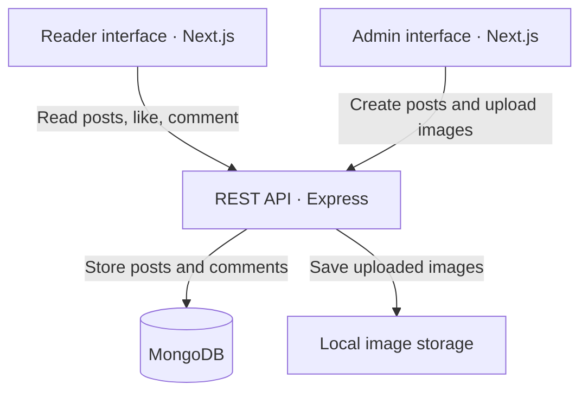

<div align="center">

# Blogs Platform

A blogging platform with dedicated reader and admin interfaces, rich-text publishing, and reader interactions.

<p>
  
  
  
  
</p>

<p>
  
  
  
</p>

[Features](#features) · [Architecture](#architecture) · [Getting Started](#getting-started) · [Roadmap](#roadmap)

</div>

## Overview

Full-Stack Blog Platform separates the reading experience from content administration.

Readers can browse published articles, open posts through unique URLs, like articles, and leave comments. Administrators can create posts with a rich-text editor, upload cover images, and choose draft or published status.

Both interfaces communicate with an Express REST API backed by MongoDB.


## Features

### Reader Interface

- Browse published blog posts.
- Read individual articles through slug-based URLs.
- Like articles and view like counts.
- Add comments without creating an account.

### Admin Interface

- View blog posts.
- Create articles using a Tiptap rich-text editor.
- Add titles, categories, and unique slugs.
- Upload cover images.
- Create posts with draft or published status.

### Backend

- REST API built with Express.
- MongoDB persistence through Mongoose.
- Image uploads handled by Multer.
- Public queries filtered to published posts.
- Like counts and comments stored with each article.

## Architecture



| Component | Responsibility |
|---|---|
| Reader application | Article browsing, reading, likes, and comments |
| Admin application | Content creation and post management interface |
| Express API | Request handling, blog operations, and file uploads |
| MongoDB | Blog content, metadata, likes, and comments |
| Local upload directory | Uploaded images served through `/uploads` |

## Tech Stack

| Layer | Technologies |
|---|---|
| Frontend | Next.js 16, React 19, TypeScript |
| Styling | Tailwind CSS |
| Rich-text editor | Tiptap |
| Backend | Node.js, Express |
| Database | MongoDB, Mongoose |
| File uploads | Multer |

## Project Structure

| Directory / File | Purpose |
|---|---|
| `blog-user/` | Reader-facing Next.js application |
| `blog-admin/` | Next.js administration interface |
| `backend/src/config/` | Database connection configuration |
| `backend/src/controllers/` | Blog request handlers |
| `backend/src/models/` | Mongoose schemas |
| `backend/src/routes/` | API route definitions |
| `backend/src/middleware/` | File upload middleware |
| `backend/src/server.js` | Express application entry point |
| `backend/uploads/` | Uploaded images |
| `.env.example` | Example environment configuration |

## Getting Started

### Prerequisites

- Node.js compatible with Next.js 16.
- npm.
- A running local MongoDB instance or a MongoDB Atlas connection string.

### 1. Install Dependencies

From the repository root, run:

```bash
npm install --prefix backend
npm install --prefix blog-user
npm install --prefix blog-admin
```

### 2. Configure the Backend

Create a `.env` file inside `backend/`:

```env
PORT=5000
MONGO_URI=mongodb://127.0.0.1:27017/blog_platform
```

If using MongoDB Atlas, replace `MONGO_URI` with your connection string.

### 3. Start the Backend

```bash
cd backend
node src/server.js
```

The API runs at `http://localhost:5000`.

### 4. Start the Reader Application

In a separate terminal, from the repository root:

```bash
cd blog-user
npm run dev -- --port 3000
```

Open [http://localhost:3000/blogs](http://localhost:3000/blogs).

### 5. Start the Admin Application

In another terminal, from the repository root:

```bash
cd blog-admin
npm run dev -- --port 3001
```

Open [http://localhost:3001/blogs](http://localhost:3001/blogs).

### Local Services

| Service | URL |
|---|---|
| Reader interface | `http://localhost:3000/blogs` |
| Admin interface | `http://localhost:3001/blogs` |
| Blog API | `http://localhost:5000/api/blogs` |
| Uploaded images | `http://localhost:5000/uploads/<filename>` |

The frontend applications currently use hardcoded API URLs pointing to `http://localhost:5000`.

## API Endpoints

Base URL: `http://localhost:5000/api/blogs`

| Method | Endpoint | Description |
|---|---|---|
| GET | `/` | Retrieve all blog posts |
| POST | `/` | Create a blog post |
| DELETE | `/id/:id` | Delete a blog post |
| GET | `/published` | Retrieve published posts |
| GET | `/slug/:slug` | Retrieve a published article |
| POST | `/slug/:slug/like` | Increment an article's like count |
| POST | `/slug/:slug/comments` | Add a comment |

For image uploads, send the create request as `multipart/form-data` with an `image` field.

## Current Limitations

- Authentication and role-based access control are not implemented. Admin API routes are currently unprotected.
- The edit interface requires backend endpoints for retrieving a post by ID and updating it.
- The admin API helper's delete URL needs to match the backend route `/id/:id`.
- Likes increment on every request without per-user tracking.
- Uploaded images are stored locally.
- Frontend API URLs are hardcoded for local development.

## Next steps

- [ ] Add authentication and protected admin routes.
- [ ] Implement role-based access control.
- [ ] Complete the blog editing workflow.
- [ ] Align the admin delete request with the backend route.
- [ ] Move frontend API URLs into environment variables.
- [ ] Add per-user like tracking.
- [ ] Redesign the landing page.
